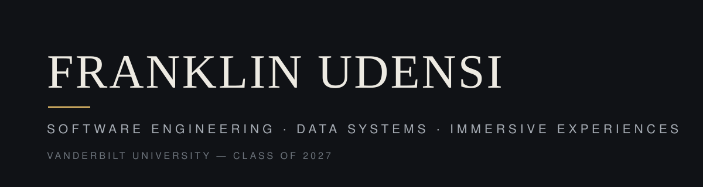

**I build systems that hold up under real-world messiness** — fraud graphs at platform scale, pharmacy inventory that started on paper ledgers, donated comics finding their way to the right readers.

I'm a senior at Vanderbilt University (BS Computer Science & Cognitive Psychology, expected May 2027) and a SyBBURE Searle Undergraduate Research Fellow. I grew up in Lagos, Nigeria. Studying cognition alongside computer science shapes how I work: I care as much about how a system behaves under load, failure, and misuse as about how a person experiences it. My work spans full-stack and backend engineering, data infrastructure, AI applications, and virtual reality.

## Featured work

### [Chapters of Change](https://github.com/VulpineCodes/chapters-of-change)

A full-stack platform that moves donated comics and manga from donors to schools, libraries, and community organizations. The engineering core is a strict donation-lifecycle state machine with server-enforced authorization, real JWT and bcrypt authentication, idempotent request handling, and a transactional outbox so status changes and notifications cannot diverge — 56 automated tests cover the workflows, including concurrent duplicate submissions and authorization failures. It starts from a conviction I grew up with: access to imaginative stories matters for children.

*TypeScript · Next.js · NestJS · PostgreSQL / Prisma · Redis / BullMQ*

### [PharmaFlow](https://github.com/VulpineCodes/pharmaflow)

A data and infrastructure platform for small independent pharmacies — the kind my father ran in Lagos — moving inventory operations off paper ledgers. Idempotent ingestion with quarantined bad rows you can actually inspect, dbt and DuckDB analytics, event streaming with exactly-once effect under crash testing, and a FastAPI serving layer. Benchmarked with the conditions published alongside the numbers: roughly 7,000 rows/second ingestion at 50,000 rows, and an analytics path profiled and optimized from 61.6 seconds to 0.49. Inventory and operations only — no patient data, ever.

*Python · FastAPI · PostgreSQL · DuckDB · dbt · event streaming*

### [Myles](https://github.com/VulpineCodes/myles)

An AI travel planner that compares options against a traveler's budget and hard constraints — and refuses to invent prices when a provider fails. Planning is deterministic and kept separate from model reasoning; every recommendation is grounded in a provider record, and a reproducible evaluation harness scores constraint satisfaction, grounding, and graceful degradation (13 of 13 cases passing). This is an independent re-architecture of the travel assistant I first built at FactSet; the original externship project is preserved at [myles-travel-buddy-](https://github.com/VulpineCodes/myles-travel-buddy-).

*Python · FastAPI · LangGraph · Next.js · evaluation harness*

### Sy-Reality!

A VR karaoke experience for Meta Quest 3: perform in immersive environments with synchronized lyrics, timed cues, and spatial interaction. Built in Unity and C# on OpenXR, structured as a complete vertical slice — one full performance loop, data-driven song definitions, and a tested timing core — rather than a collection of unfinished mechanics. It grows directly out of my VR research work at Vanderbilt's Wallace Multisensory Lab. In active development.

*Unity · C# · OpenXR · Meta Quest 3*

## Experience

**Microsoft** — Software Engineering Intern, Xbox Commerce Feeds & Risk · May–Aug 2026
Built a fraud investigation tool (Node.js, KQL / Azure Data Explorer, Cytoscape.js) whose two-hop graph expansion cut investigation time from about an hour to 5 seconds. Integrated an AI fraud-signal service through MCP with a four-tier fallback, and hardened the tool through privacy review and KQL-injection defenses.

**Vanderbilt Wallace Multisensory Lab** — Software Developer Intern · Jun–Dec 2025
Built VR research paradigms for The Cave, a Meta Reality Labs–funded immersive facility. Authored 4+ reusable Unity templates used across 10+ neuroscience experiments.

**FactSet** — Software Engineering Extern · May 2025
Led a 3-person team building Myles, an AI travel assistant integrating 5+ APIs, and pitched the result to 30+ engineers and product leads.

**ColorStack Vanderbilt** — Founding Member & Outreach Chair · 2023–present
Helped found the Vanderbilt chapter and grew its membership from 15 to 120+ students.

## Background

- Vanderbilt University — BS Computer Science & Cognitive Psychology, expected May 2027
- SyBBURE Searle Undergraduate Research Fellow, 2025
- H.H. Morgan Memorial Award for Writers, 2024
- Study abroad, Spring 2026 — Kyoto, Sydney, Madrid

## Tools I work with

- **Languages** — TypeScript, Python, Java, C, C++, C#, JavaScript, SQL
- **Web & backend** — React, Next.js, NestJS, Node.js, FastAPI
- **Data & infrastructure** — PostgreSQL, DuckDB, dbt, Redis, Docker, Kubernetes, Kafka-style event streaming, KQL / Azure Data Explorer, AWS, Azure
- **AI** — LangGraph, MCP, evaluation harnesses, grounded generation
- **Immersive** — Unity, OpenXR, Meta Quest

## Elsewhere

- GitHub — [github.com/VulpineCodes](https://github.com/VulpineCodes)
- LinkedIn — [linkedin.com/in/franklinudensi](https://www.linkedin.com/in/franklinudensi)
- Email — [franklin.c.udensi@gmail.com](mailto:franklin.c.udensi@gmail.com)
